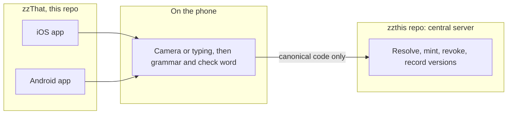

# zzThat

  <strong>Free for everyone. Write a code on a lost-pet flyer, a moving box, a garage-sale item, or a note, and anyone can scan it, like a QR code you can write by hand.</strong> 
  [MICHAEL 2026-10-02]

  <a href="specs/README.md">Specs</a> ·
  <a href=".specify/memory/constitution.md">Constitution</a> ·
  <a href="https://github.com/orgs/Zero-State-LLC/projects/25">Board</a> ·
  <a href="https://github.com/Zero-State-LLC/zzthat/issues">Issues</a> ·
  <a href="https://github.com/Zero-State-LLC/zzthis">zzThis</a> ·
  <a href="https://github.com/Zero-State-LLC/zzthis/blob/08a3c26f78004e885c0405e662135112133144ed/docs/SPEC.md">zzThis spec pin</a>

  
  
  
  

Topics: `human-readable-codes` `handwritten-codes` `ios` `android` `swift` `kotlin` `prototype`

zzThat is the free everyday-use iOS and Android apps for zz codes. A person writes a code such as `zz-kathy-lost-cat-zz` on a lost-pet flyer, a moving box, a garage-sale item, or a note, and anyone can scan it, like a QR code you can write by hand [MICHAEL 2026-10-02].

zzThat is the apps portion of [zzThis](https://github.com/Zero-State-LLC/zzthis). The apps are thin clients. They call the zzThis central server to resolve, issue, and manage codes. They do not run a resolver [DANNY 2026-10-04]. The later web client is built in that same repo.

This repository holds the governing spec, repo tooling, and native iOS and Android application source. The implementation is in progress and is not a production release.

## Contents

- [Status](#status)
- [Board](KANBAN.md)
- [Design tokens](#design-tokens)
- [Repository atlas](#repository-atlas)
- [Architecture](#architecture)
- [Roadmap](#roadmap)
- [Contributing](#contributing)
- [License](#license)

## Status

zzThat is in **implementation and verification**. Native iOS and Android source, shared grammar code, generated API-client plumbing, tests, and app CI are present. On-device text recognition uses Apple Vision on iOS and ML Kit on Android, followed by the pinned grammar/check-word pipeline. The apps are **not release-qualified**: the ZZ-OCR-QUAL-001 receipt, device qualification evidence, staging end-to-end verification, and store readiness remain open. This repo does not claim an accuracy result. The central resolver and authoritative wordlist remain zzThis [ZZTHIS SPEC]. The readable board is [KANBAN.md](KANBAN.md).

- iOS and Android ship together from this repo. The later web client is built in [zzthis](https://github.com/Zero-State-LLC/zzthis), which is also the central server [DANNY 2026-10-04]. The site that repo publishes today is the marketing page for zzThis ([ZQ1](https://github.com/Zero-State-LLC/zzthat/issues/1)). "Try zzThat" links to that page, `https://zero-state-llc.github.io/zzthis/` ([ZQ2](https://github.com/Zero-State-LLC/zzthat/issues/2)).
- Everyday codes are free public codes. zzThis adopted that scope for v1.1 (D-2026-10-10-21), and Create in the apps mints them ([ZQ3](https://github.com/Zero-State-LLC/zzthat/issues/3)). The server chooses the words ([ZQ11](https://github.com/Zero-State-LLC/zzthat/issues/11)).
- Questions [#1](https://github.com/Zero-State-LLC/zzthat/issues/1) to [#21](https://github.com/Zero-State-LLC/zzthat/issues/21) are decided in [the decisions log](specs/001-zzthat-apps/decisions.md). The apps are native SwiftUI and Jetpack Compose, on iOS 17 and Android 8.
- Spec lint runs in [`.github/workflows/ci.yml`](.github/workflows/ci.yml). Native app checks are defined in [`.github/workflows/apps-ci.yml`](.github/workflows/apps-ci.yml); iOS CI is label/manual gated. End-to-end orchestration is in [`.github/workflows/apps-e2e.yml`](.github/workflows/apps-e2e.yml). A passing CI run, or a workflow's presence, does not by itself qualify a release.
- The qualification harness is in the repo (`zz-qual`, `scripts/qual-android.sh`, T027, [#94](https://github.com/Zero-State-LLC/zzthat/pull/94)). A rendered `zz-copper-lantern-sky-zz` is a smoke, not a handwriting result. A truth-file quick run is not the ZZ-OCR-QUAL-001 receipt.

## Design tokens

This repo does not publish its own colors, type, spacing, fonts, icons, or sentences. zzThat pins zzThis at one sha, recorded in `contracts/ZZTHIS-API-PIN`, and `scripts/sync-zzthis.sh` copies the design files, `copy.json`, the OpenAPI file, the test vectors, and the wordlist from that sha. The rules and the current sha are in [`specs/001-zzthat-apps/design.md`](specs/001-zzthat-apps/design.md). Token values are the generated Swift and Kotlin files from that pin, not a second palette.

## Repository atlas

| Path | What it holds |
|---|---|
| [`.specify/memory/constitution.md`](.specify/memory/constitution.md) | Governing rules for every spec in this repo |
| [`specs/README.md`](specs/README.md) | Spec index, zzThis pin, and the issue map |
| [`specs/001-zzthat-apps/spec.md`](specs/001-zzthat-apps/spec.md) | What the apps do, and the app rules for the pinned API contract |
| [`specs/001-zzthat-apps/runtime.md`](specs/001-zzthat-apps/runtime.md) | Build contract: structure, screens, auth, storage, release |
| [`specs/001-zzthat-apps/design.md`](specs/001-zzthat-apps/design.md) | How the apps consume zzthis `design/` |
| [`specs/001-zzthat-apps/decisions.md`](specs/001-zzthat-apps/decisions.md) | ZQ1 to ZQ28: ZQ1 to ZQ26 decided 2026-10-04, ZQ27 (CI spend) and ZQ28 (toolchain pins) decided 2026-10-05 by established practice. |
| [`specs/001-zzthat-apps/plan.md`](specs/001-zzthat-apps/plan.md) | Stack, build order, and risks |
| [`specs/001-zzthat-apps/tasks.md`](specs/001-zzthat-apps/tasks.md) | Task groups TG1 to TG9, then Phases 10 to 13 (whole-system check, store readiness, v1.1) |
| [`KANBAN.md`](KANBAN.md) | Readable board. It does not move the GitHub project cards. |
| [`apps/ios`](apps/ios) | SwiftUI app, and the `ZZCore`, `ZZAPI`, and `ZZDesign` packages |
| [`apps/android`](apps/android) | Jetpack Compose app, and the `core-*` modules |
| [`apps/store`](apps/store) | Store listing, privacy, and review drafts (Danny submits) |
| [`contracts/zzthis-v1.openapi.yaml`](contracts/zzthis-v1.openapi.yaml) | Pinned copy of zzthis `specs/005-v1-api/openapi.yaml` |
| [`scripts/lint-specs.py`](scripts/lint-specs.py) | Spec lint, over the files `git ls-files` lists |
| [`.gitignore`](.gitignore) | Generated and local paths, never committed or linted |
| [`.github/workflows/ci.yml`](.github/workflows/ci.yml) | Spec lint on pull requests and on `main` |
| [`.github/workflows/project-collaboration.yml`](.github/workflows/project-collaboration.yml) | Adds new issues and pull requests to the board |
| [`AGENTS.md`](AGENTS.md) | Contract for coding agents |
| [`CONTRIBUTING.md`](CONTRIBUTING.md) | How to open a change |
| [`README.md`](README.md) | This file |

zzThis, not this repo, holds the central server, the later web client, the marketing page, the grammar, the resolver, the wordlist, and capture. The pin is commit `08a3c26f78004e885c0405e662135112133144ed`, recorded in `contracts/ZZTHIS-API-PIN`.

| zzThis path | Role for these apps |
|---|---|
| `docs/SPEC.md` Section 2.2a | v1 text grammar |
| `docs/SPEC.md` Section 10 | Central server, on-device capture, offline rules |
| `docs/SPEC.md` Section 12 | v1 scope and v2 candidates, including free public codes |
| `specs/002-resolver-core` | Server behavior the client calls |
| `specs/003-wordlist-checkword` | Wordlist, check word, grammar library |
| `specs/004-capture` | Camera, typing, and voice |
| `design/` and `scripts/pin-zzthis.sh` | Tokens, generated Swift and Kotlin, fonts, masters, UX patterns, `copy.json`. Pin `08a3c26f78004e885c0405e662135112133144ed` |
| `specs/005-v1-api` and `docs/ONE-SHOT-BRIEF.md` | The `/v1` contract and the one-shot build brief |

## Architecture

The apps are thin clients [DANNY 2026-10-04]. One zzThis server owns codes, records, grants, and the audit log. Revocation, single use, expiry, and rate limits are enforced there [ZZTHIS SPEC]. The server is built in zzThis; its production launch is Danny's call. The diagram is the client view of contract 1, the pinned zzThis spec 005 OpenAPI, limited to what zzThat calls.

V1 recognition is on-device only. Images, crops, and OCR transcripts are never sent to the server; ordinary resolution receives only the selected canonical code. The `photo_reads` capability does not opt the client into a photo endpoint. Any future server-side photo reading requires a separate product, privacy, and security decision.

The apps do not cache a source of truth. Only an active reusable public unauthenticated resolve may be kept, and only for the server's `Cache-Control` (`public, max-age=60, stale-while-revalidate=300`). Every other `/v1` response is `no-store` [ZZTHIS SPEC] spec 005 FR-018 and FR-028. They cannot issue or revoke offline.

## Roadmap

Work is tracked as GitHub issues, on the [zzThat board](https://github.com/orgs/Zero-State-LLC/projects/25), and in [KANBAN.md](KANBAN.md). ZQ1 to ZQ21 are decided. Task groups are [#22](https://github.com/Zero-State-LLC/zzthat/issues/22) to [#30](https://github.com/Zero-State-LLC/zzthat/issues/30).

### Phase 0: Spec and native implementation

- [x] Constitution, spec 001, plan, tasks, and checklist
- [x] Decide ZQ1 to ZQ21 ([#1](https://github.com/Zero-State-LLC/zzthat/issues/1) to [#21](https://github.com/Zero-State-LLC/zzthat/issues/21), [log](specs/001-zzthat-apps/decisions.md))
- [x] One issue per task group ([#22](https://github.com/Zero-State-LLC/zzthat/issues/22) to [#30](https://github.com/Zero-State-LLC/zzthat/issues/30))
- [x] Runtime build contract and the design pin (`scripts/pin-design.sh`)
- [ ] Danny accepts the spec

### Phase 1: Native capture and qualification

- [x] Native SwiftUI and Compose app source and platform OCR readers ([#22](https://github.com/Zero-State-LLC/zzthat/issues/22), [#24](https://github.com/Zero-State-LLC/zzthat/issues/24))
- [x] API client generated from the pinned OpenAPI, contract 1 ([#23](https://github.com/Zero-State-LLC/zzthat/issues/23))
- [x] Commit-bound app CI is in [`.github/workflows/apps-ci.yml`](.github/workflows/apps-ci.yml) and [`.github/workflows/apps-e2e.yml`](.github/workflows/apps-e2e.yml). iOS CI is label or manual gated.
- [ ] Device qualification and the ZZ-OCR-QUAL-001 receipt ([#24](https://github.com/Zero-State-LLC/zzthat/issues/24), [#26](https://github.com/Zero-State-LLC/zzthat/issues/26)). A rendered smoke and a truth-file quick run are not that receipt.
- [ ] Staging end-to-end verification with canonical-code-only resolve; no production promotion until evidence is accepted

### Phase 2: Remaining everyday flows and release gates

Live mint stays blocked until the zzThis server adds free public codes ([ZQ3](https://github.com/Zero-State-LLC/zzthat/issues/3)). The server chooses the words ([ZQ11](https://github.com/Zero-State-LLC/zzthat/issues/11)).

- [x] Create a code ([#25](https://github.com/Zero-State-LLC/zzthat/issues/25), closed completed). Live mint still waits on the server.
- [ ] Scan and resolve ([#26](https://github.com/Zero-State-LLC/zzthat/issues/26)). Typed resolve is built. The camera handoff and a qualification receipt are not.
- [x] Share and manage ([#27](https://github.com/Zero-State-LLC/zzthat/issues/27), closed completed)
- [x] Offline cache ([#28](https://github.com/Zero-State-LLC/zzthat/issues/28), closed completed)

### Phase 3: Accounts and stores

- [ ] Permissions, sign-in, privacy, and accessibility ([#29](https://github.com/Zero-State-LLC/zzthat/issues/29))
- [ ] Store readiness, without submitting ([#30](https://github.com/Zero-State-LLC/zzthat/issues/30))

## Contributing

See [CONTRIBUTING.md](CONTRIBUTING.md). Run `python3 scripts/lint-specs.py` before you push. Danny accepts product specs. Store submission and spend need his yes.

## License

Proprietary, all rights reserved. See [`LICENSE`](LICENSE). No use, copying, modification, or distribution is permitted without prior written permission.
