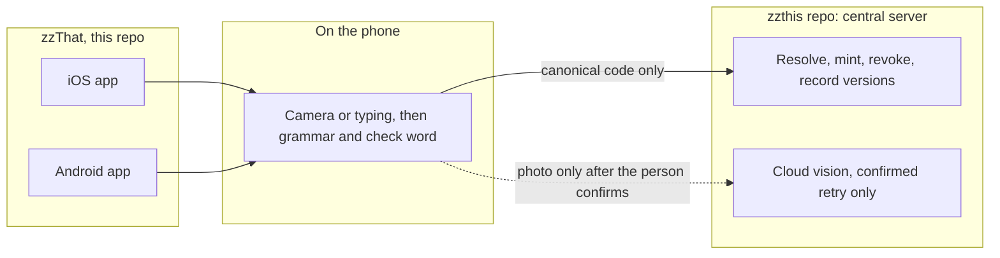

# zzThat

  <strong>Free for everyone. Write a code on a lost-pet flyer, a moving box, a garage-sale item, or a note, and anyone can scan it, like a QR code you can write by hand.</strong> 
  [MICHAEL 2026-10-02]

  <a href="specs/README.md">Specs</a> ·
  <a href=".specify/memory/constitution.md">Constitution</a> ·
  <a href="https://github.com/orgs/Zero-State-LLC/projects/25">Board</a> ·
  <a href="https://github.com/Zero-State-LLC/zzthat/issues">Issues</a> ·
  <a href="https://github.com/Zero-State-LLC/zzthis">zzThis</a> ·
  <a href="https://github.com/Zero-State-LLC/zzthis/blob/0a5c9b93e8f8266ff9d0855f4afe2dafbe1d26d7/docs/SPEC.md">zzThis spec pin</a>

  
  
  
  

Topics: `human-readable-codes` `handwritten-codes` `ios` `android` `swift` `kotlin` `prototype`

zzThat is the free everyday-use iOS and Android apps for zz codes. A person writes a code such as `zz-kathy-lost-cat-zz` on a lost-pet flyer, a moving box, a garage-sale item, or a note, and anyone can scan it, like a QR code you can write by hand [MICHAEL 2026-10-02].

zzThat is the apps portion of [zzThis](https://github.com/Zero-State-LLC/zzthis). The apps are thin clients. They call the zzThis central server to resolve, issue, and manage codes. They do not run a resolver [DANNY 2026-10-04]. The later web client is built in that same repo.

This repository holds the spec and the repo tooling. It does not hold app source yet.

## Contents

- [Status](#status)
- [Design tokens](#design-tokens)
- [Repository atlas](#repository-atlas)
- [Architecture](#architecture)
- [Roadmap](#roadmap)
- [Contributing](#contributing)
- [License](#license)

## Status

zzThat is a **specification**. The apps are not built. Recognition, the resolver, and the wordlist are untested in zzThis, and this repo does not claim results [ZZTHIS SPEC].

- iOS and Android ship together from this repo. The later web client is built in [zzthis](https://github.com/Zero-State-LLC/zzthis), which is also the central server [DANNY 2026-10-04]. The site that repo publishes today is the marketing page for zzThis ([ZQ1](https://github.com/Zero-State-LLC/zzthat/issues/1)). "Try zzThat" links to that page, `https://zero-state-llc.github.io/zzthis/` ([ZQ2](https://github.com/Zero-State-LLC/zzthat/issues/2)).
- Everyday codes are free public codes. The zzThis resolver spec lists that scope as v2 [ZZTHIS SPEC]. Create stays unavailable until the server adds it ([ZQ3](https://github.com/Zero-State-LLC/zzthat/issues/3)). The server chooses the words ([ZQ11](https://github.com/Zero-State-LLC/zzthat/issues/11)).
- Questions [#1](https://github.com/Zero-State-LLC/zzthat/issues/1) to [#21](https://github.com/Zero-State-LLC/zzthat/issues/21) are decided in [the decisions log](specs/001-zzthat-apps/decisions.md). The apps are native SwiftUI and Jetpack Compose, on iOS 17 and Android 8.
- Spec lint runs in [`.github/workflows/ci.yml`](.github/workflows/ci.yml). The badge above tracks that workflow on `main` after this branch merges. App test CI is not added until the test targets exist.

## Design tokens

This repo does not publish colors, type, spacing, or icons. Those values will come from zzthis `design/` (tokens JSON, generated Swift and Kotlin, logo and icon masters, UX patterns). The consumption rules are in [`specs/001-zzthat-apps/design.md`](specs/001-zzthat-apps/design.md).

TODO: `design/` is not on zzthis `main` at the pin above (checked 2026-10-04). Do not paste stand-in values here. The marketing site's CSS tokens are not a substitute.

## Repository atlas

| Path | What it holds |
|---|---|
| [`.specify/memory/constitution.md`](.specify/memory/constitution.md) | Governing rules for every spec in this repo |
| [`specs/README.md`](specs/README.md) | Spec index, zzThis pin, and the issue map |
| [`specs/001-zzthat-apps/spec.md`](specs/001-zzthat-apps/spec.md) | What the apps do, and the proposed API contract |
| [`specs/001-zzthat-apps/runtime.md`](specs/001-zzthat-apps/runtime.md) | Build contract: structure, screens, auth, storage, release |
| [`specs/001-zzthat-apps/design.md`](specs/001-zzthat-apps/design.md) | How the apps consume zzthis `design/` |
| [`specs/001-zzthat-apps/decisions.md`](specs/001-zzthat-apps/decisions.md) | ZQ1 to ZQ21, decided 2026-10-04 |
| [`specs/001-zzthat-apps/plan.md`](specs/001-zzthat-apps/plan.md) | Stack, build order, and risks |
| [`specs/001-zzthat-apps/tasks.md`](specs/001-zzthat-apps/tasks.md) | Task groups TG1 to TG9 |
| [`contracts/zzthis-v1.openapi.yaml`](contracts/zzthis-v1.openapi.yaml) | PROPOSAL OpenAPI for client generation |
| [`scripts/lint-specs.py`](scripts/lint-specs.py) | Spec lint |
| [`.github/workflows/ci.yml`](.github/workflows/ci.yml) | Spec lint on pull requests and on `main` |
| [`.github/workflows/project-collaboration.yml`](.github/workflows/project-collaboration.yml) | Adds new issues and pull requests to the board |
| [`AGENTS.md`](AGENTS.md) | Contract for coding agents |
| [`CONTRIBUTING.md`](CONTRIBUTING.md) | How to open a change |
| [`README.md`](README.md) | This file |

zzThis, not this repo, holds the central server, the later web client, the marketing page, the grammar, the resolver, the wordlist, and capture. The pin is commit `0a5c9b93e8f8266ff9d0855f4afe2dafbe1d26d7`.

| zzThis path | Role for these apps |
|---|---|
| `docs/SPEC.md` Section 2.2a | v1 text grammar |
| `docs/SPEC.md` Section 10 | Central server, on-device capture, offline rules |
| `docs/SPEC.md` Section 12 | v1 scope and v2 candidates, including free public codes |
| `specs/002-resolver-core` | Server behavior the client calls |
| `specs/003-wordlist-checkword` | Wordlist, check word, grammar library |
| `specs/004-capture` | Camera, typing, and voice |
| `design/` | Tokens, generated Swift and Kotlin, masters, UX patterns. TODO: not on `main` yet |

## Architecture

The apps are thin clients [DANNY 2026-10-04]. One zzThis server owns codes, records, grants, and the audit log. Revocation, single use, expiry, and rate limits are enforced there [ZZTHIS SPEC]. Nothing in that server is built. The diagram is the client view of the zzThis proposal, limited to what zzThat calls.

The apps do not cache a source of truth. They may show a signed public record for a short time without a connection. They cannot issue or revoke offline [ZZTHIS SPEC].

## Roadmap

Work is tracked as GitHub issues and on the [zzThat board](https://github.com/orgs/Zero-State-LLC/projects/25). ZQ1 to ZQ21 are decided. Task groups are [#22](https://github.com/Zero-State-LLC/zzthat/issues/22) to [#30](https://github.com/Zero-State-LLC/zzthat/issues/30).

### Phase 0: Spec

- [x] Constitution, spec 001, plan, tasks, and checklist
- [x] Decide ZQ1 to ZQ21 ([#1](https://github.com/Zero-State-LLC/zzthat/issues/1) to [#21](https://github.com/Zero-State-LLC/zzthat/issues/21), [log](specs/001-zzthat-apps/decisions.md))
- [x] One issue per task group ([#22](https://github.com/Zero-State-LLC/zzthat/issues/22) to [#30](https://github.com/Zero-State-LLC/zzthat/issues/30))
- [x] Runtime build contract and the design consumption TODO
- [ ] Danny accepts the spec

### Phase 1: Scaffold and on-device grammar

- [ ] Platform scaffold, SwiftUI and Compose ([#22](https://github.com/Zero-State-LLC/zzthat/issues/22))
- [ ] Grammar vectors on both platforms ([#24](https://github.com/Zero-State-LLC/zzthat/issues/24))
- [ ] API client generated from the OpenAPI proposal ([#23](https://github.com/Zero-State-LLC/zzthat/issues/23))

### Phase 2: Everyday flows

Live mint stays blocked until the zzThis server adds free public codes ([ZQ3](https://github.com/Zero-State-LLC/zzthat/issues/3)). The server chooses the words ([ZQ11](https://github.com/Zero-State-LLC/zzthat/issues/11)).

- [ ] Create a code ([#25](https://github.com/Zero-State-LLC/zzthat/issues/25))
- [ ] Scan and resolve ([#26](https://github.com/Zero-State-LLC/zzthat/issues/26))
- [ ] Share and manage ([#27](https://github.com/Zero-State-LLC/zzthat/issues/27))
- [ ] Offline cache ([#28](https://github.com/Zero-State-LLC/zzthat/issues/28))

### Phase 3: Accounts and stores

- [ ] Permissions, sign-in, privacy, and accessibility ([#29](https://github.com/Zero-State-LLC/zzthat/issues/29))
- [ ] Store readiness, without submitting ([#30](https://github.com/Zero-State-LLC/zzthat/issues/30))

## Contributing

See [CONTRIBUTING.md](CONTRIBUTING.md). Run `python3 scripts/lint-specs.py` before you push. Danny accepts product specs. Store submission and spend need his yes.

## License

No license file is in this repository yet. zzThis is proprietary, all rights reserved. Whether this repo uses that same text is Danny's decision. Do not assume a grant of rights from this README.
