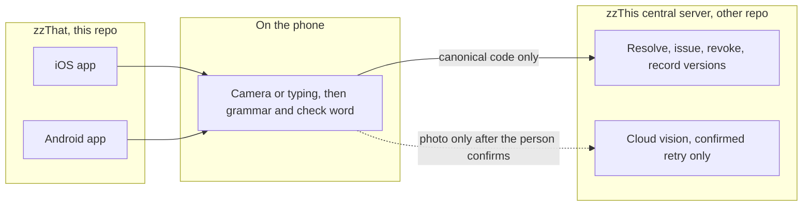

# zzThat

  <strong>Free for everyone. Write a code on a lost-pet flyer, a moving box, a garage-sale item, or a note, and anyone can scan it, like a QR code you can write by hand.</strong> 
  [MICHAEL 2026-10-02]

  <a href="specs/README.md">Specs</a> ·
  <a href=".specify/memory/constitution.md">Constitution</a> ·
  <a href="https://github.com/Zero-State-LLC/zzthat/issues?q=is%3Aissue+is%3Aopen+label%3Aquestion">Open questions</a> ·
  <a href="https://github.com/Zero-State-LLC/zzthis">zzThis</a> ·
  <a href="https://github.com/Zero-State-LLC/zzthis/blob/0a5c9b93e8f8266ff9d0855f4afe2dafbe1d26d7/docs/SPEC.md">zzThis spec pin</a>

  
  
  

zzThat is the free everyday-use iOS and Android apps for zz codes. A person writes a code such as `zz-kathy-lost-cat-zz` on a lost-pet flyer, a moving box, a garage-sale item, or a note, and anyone can scan it, like a QR code you can write by hand [MICHAEL 2026-10-02].

zzThat is the apps portion of [zzThis](https://github.com/Zero-State-LLC/zzthis). The apps are thin clients. They call the zzThis central server to resolve, issue, and manage codes. They do not run a resolver [DANNY 2026-10-04].

This repository holds the spec. It does not hold app source yet.

## Contents

- [Status](#status)
- [Repository atlas](#repository-atlas)
- [Architecture](#architecture)
- [Roadmap](#roadmap)
- [Contributing](#contributing)
- [License](#license)

## Status

zzThat is a **specification**. The apps are not built. Recognition, the resolver, and the wordlist are untested in zzThis, and this repo does not claim results [ZZTHIS SPEC].

- iOS and Android ship together. A web client is not built from this repo [DANNY 2026-10-04]. The zzThis copy still says the app is coming to the web at zzthat.com [MICHAEL 2026-10-02]. That web client is later, and it is not this repo ([ZQ1](https://github.com/Zero-State-LLC/zzthat/issues/1)).
- Everyday codes are free public codes. The zzThis resolver spec lists that scope as v2 [ZZTHIS SPEC]. Create stays unavailable until the server adds it ([ZQ3](https://github.com/Zero-State-LLC/zzthat/issues/3)).
- Questions [#1](https://github.com/Zero-State-LLC/zzthat/issues/1) to [#21](https://github.com/Zero-State-LLC/zzthat/issues/21) are decided in [the decisions log](specs/001-zzthat-apps/decisions.md). The apps are native SwiftUI and Jetpack Compose, on iOS 17 and Android 8.
- There is no CI workflow yet. A build badge would point at a file that does not exist.

## Repository atlas

| Path | What it holds |
|---|---|
| [`.specify/memory/constitution.md`](.specify/memory/constitution.md) | Governing rules for every spec in this repo |
| [`specs/README.md`](specs/README.md) | Spec index, zzThis pin, and the issue map |
| [`specs/001-zzthat-apps/spec.md`](specs/001-zzthat-apps/spec.md) | What the apps do, and the proposed API contract |
| [`specs/001-zzthat-apps/decisions.md`](specs/001-zzthat-apps/decisions.md) | ZQ1 to ZQ21, decided 2026-10-04 |
| [`specs/001-zzthat-apps/plan.md`](specs/001-zzthat-apps/plan.md) | Stack default, build order, and risks |
| [`specs/001-zzthat-apps/tasks.md`](specs/001-zzthat-apps/tasks.md) | Task groups TG1 to TG9 |
| [`specs/001-zzthat-apps/checklists/requirements.md`](specs/001-zzthat-apps/checklists/requirements.md) | Spec-quality checklist |
| [`README.md`](README.md) | This file |

zzThis, not this repo, holds the grammar, the resolver, the wordlist, and capture. The pin is commit `0a5c9b93e8f8266ff9d0855f4afe2dafbe1d26d7`.

| zzThis path | Role for these apps |
|---|---|
| `docs/SPEC.md` Section 2.2a | v1 text grammar |
| `docs/SPEC.md` Section 10 | Central server, on-device capture, offline rules |
| `docs/SPEC.md` Section 12 | v1 scope and v2 candidates, including free public codes |
| `specs/002-resolver-core` | Server behavior the client calls |
| `specs/003-wordlist-checkword` | Wordlist, check word, grammar library |
| `specs/004-capture` | Camera, typing, and voice |

## Architecture

The apps are thin clients [DANNY 2026-10-04]. One zzThis server owns codes, records, grants, and the audit log. Revocation, single use, expiry, and rate limits are enforced there [ZZTHIS SPEC]. Nothing in that server is built. The diagram is the client view of the zzThis proposal, limited to what zzThat calls.

The apps do not cache a source of truth. They may show a signed public record for a short time without a connection. They cannot issue or revoke offline [ZZTHIS SPEC].

## Roadmap

Work is tracked as GitHub issues. ZQ1 to ZQ21 are decided. Task groups are [#22](https://github.com/Zero-State-LLC/zzthat/issues/22) to [#30](https://github.com/Zero-State-LLC/zzthat/issues/30).

### Phase 0: Spec

- [x] Constitution, spec 001, plan, tasks, and checklist
- [x] Decide ZQ1 to ZQ21 ([#1](https://github.com/Zero-State-LLC/zzthat/issues/1) to [#21](https://github.com/Zero-State-LLC/zzthat/issues/21), [log](specs/001-zzthat-apps/decisions.md))
- [x] One issue per task group ([#22](https://github.com/Zero-State-LLC/zzthat/issues/22) to [#30](https://github.com/Zero-State-LLC/zzthat/issues/30))
- [ ] Danny accepts the spec

### Phase 1: Scaffold and on-device grammar

- [ ] Platform scaffold, SwiftUI and Compose ([#22](https://github.com/Zero-State-LLC/zzthat/issues/22))
- [ ] Grammar vectors on both platforms ([#24](https://github.com/Zero-State-LLC/zzthat/issues/24))
- [ ] API client fixtures ([#23](https://github.com/Zero-State-LLC/zzthat/issues/23))

### Phase 2: Everyday flows

Live claim stays blocked until the zzThis server adds free public codes ([ZQ3](https://github.com/Zero-State-LLC/zzthat/issues/3)).

- [ ] Create a code ([#25](https://github.com/Zero-State-LLC/zzthat/issues/25))
- [ ] Scan and resolve ([#26](https://github.com/Zero-State-LLC/zzthat/issues/26))
- [ ] Share and manage ([#27](https://github.com/Zero-State-LLC/zzthat/issues/27))
- [ ] Offline cache ([#28](https://github.com/Zero-State-LLC/zzthat/issues/28))

### Phase 3: Accounts and stores

- [ ] Permissions, sign-in, and the safety gaps ([#29](https://github.com/Zero-State-LLC/zzthat/issues/29))
- [ ] Store readiness, without submitting ([#30](https://github.com/Zero-State-LLC/zzthat/issues/30))

## Contributing

1. Read the [constitution](.specify/memory/constitution.md) and [spec 001](specs/001-zzthat-apps/spec.md) before adding app source.
2. Do not invent grammar, resolver, or capture rules. Reference the pinned zzThis specs.
3. Tag new product claims. Use [ZZTHIS SPEC], [MICHAEL date], [DANNY date], or [INFERRED].
4. User-facing copy says "demo", says "check word", and uses no em dashes.
5. Open a pull request. Danny accepts product specs. Store submission and spend need his yes.

## License

No license file is in this repository yet. zzThis is proprietary, all rights reserved. Whether this repo uses that same text is Danny's decision. Do not assume a grant of rights from this README.
